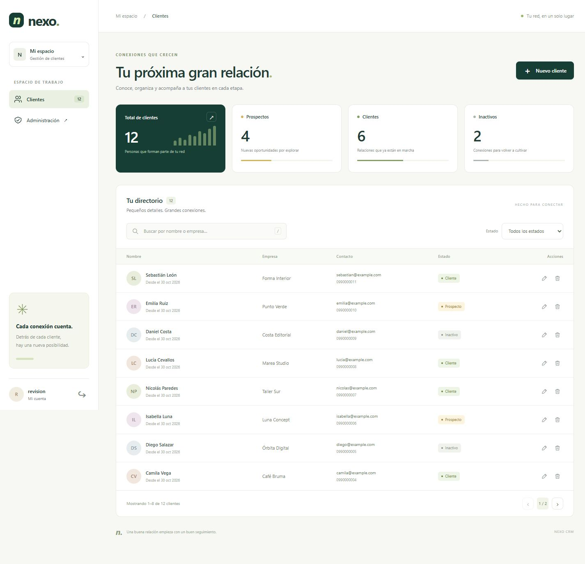

# Nexo · Mini CRM de clientes

Un directorio para conocer, organizar y acompañar a cada cliente. Desarrollado para el desafío técnico de CEO Marketing con Django, HTML semántico, CSS propio y JavaScript Vanilla.



[Vista móvil](docs/screenshots/mobile.jpg) · [Formulario móvil](docs/screenshots/mobile-form.jpg) · [Vista tablet](docs/screenshots/tablet.jpg)

## Qué incluye

- Dashboard con totales de prospectos, clientes e inactivos.
- Registro y edición en modal; eliminación con confirmación previa.
- Búsqueda por nombre o empresa y filtro por estado, combinables y sin recargar.
- Paginación de ocho registros, contadores globales y resultados filtrados.
- Validación en navegador y servidor, errores por campo, toast y bloqueo durante el envío.
- Estados vacíos, carga, recuperación ante errores y cancelación de búsquedas anteriores.
- Diseño para escritorio, tablet y móvil; el listado se convierte en tarjetas en móvil.
- Inicio de sesión, protección CSRF y gestión completa desde Django Admin.
- SQLite persistente, datos ficticios opcionales y 15 pruebas automatizadas.
- Docker Compose y GitHub Actions con validación, pruebas y comprobación del contenedor.

## Ejecutar con Python

Requisitos: Python 3.12 y Git. No se necesita Node.js para ejecutar el CRM. Los comandos se ejecutan desde la carpeta que contiene `manage.py`.

```bash
git clone https://github.com/Billygg2/nexo-mini-crm.git
cd nexo-mini-crm
python -m venv .venv
```

Activa el entorno:

```powershell
# Windows PowerShell
.venv\Scripts\Activate.ps1
```

```bash
# macOS / Linux
source .venv/bin/activate
```

Si PowerShell no permite activar scripts, usa `.venv\Scripts\python.exe` en lugar de `python` en los comandos siguientes; no es necesario modificar la política de ejecución.

```bash
python -m pip install -r requirements.txt
python manage.py migrate
python manage.py collectstatic --noinput
python manage.py createsuperuser
python manage.py seed_demo
python manage.py runserver
```

Abre **http://127.0.0.1:8000/** e inicia sesión con el usuario y contraseña que acabas de crear. El mismo usuario puede entrar en **http://127.0.0.1:8000/admin/**. Si ese puerto está ocupado, usa `python manage.py runserver 8123` y abre http://127.0.0.1:8123/.

`seed_demo` es opcional: crea doce clientes ficticios con correos `example.com`, no crea usuarios ni contraseñas y puede ejecutarse varias veces sin duplicar registros. Para revisar el estado vacío, omite este comando en una instalación nueva.

## Ejecutar con Docker

Requisitos: Docker Engine con el complemento Compose o Docker Desktop iniciado, usando contenedores Linux.

1. Copia `.env.example` a `.env` (`Copy-Item .env.example .env` en PowerShell; `cp .env.example .env` en macOS/Linux).
2. Genera una clave con `python -c "import secrets; print(secrets.token_urlsafe(50))"` y pégala como valor de `DJANGO_SECRET_KEY` en `.env`. Mantén este archivo fuera de Git. El contenedor exige esta clave y usa `DEBUG=0`.
3. Ejecuta:

```bash
docker compose up --build -d --wait
docker compose exec web python manage.py createsuperuser
docker compose exec web python manage.py seed_demo
```

Abre **http://127.0.0.1:8000/**. Al iniciar el contenedor se aplican automáticamente las migraciones. Gunicorn sirve Django y WhiteNoise sirve los archivos estáticos. El proceso se ejecuta con un usuario sin privilegios.

```bash
docker compose logs -f web
docker compose exec web python manage.py test
docker compose down
```

Los datos se conservan en el volumen `crm_data` aunque se detenga o reconstruya el contenedor. `docker compose down -v` elimina el volumen y sus datos: no lo uses si quieres conservarlos. El puerto se publica únicamente en la máquina local.

## Validar el proyecto

```bash
python manage.py check
python manage.py makemigrations --check --dry-run
python manage.py collectstatic --noinput
python manage.py test
```

La recolección de archivos estáticos se hace antes de las pruebas porque WhiteNoise usa un manifiesto de archivos versionados. Las quince pruebas comprueban CRUD, datos requeridos y opcionales, teléfonos, correo único sin distinguir mayúsculas, búsquedas, filtros combinados, métricas, paginación, JSON inválido, acceso, CSRF, Admin, salud y carga repetible de datos.

Si tienes Node.js, puedes verificar la sintaxis del frontend con `node --check clients/static/clients/app.js`.

### Recorrido manual de revisión

1. Inicia sesión y comprueba los totales del dashboard.
2. Añade un cliente; revisa su aparición en la primera página y la notificación.
3. Edita su empresa y cambia su estado a Cliente.
4. Busca su nombre o empresa y combina la búsqueda con un estado.
5. Prueba una búsqueda sin coincidencias y el botón para limpiar filtros.
6. Intenta reutilizar un correo: debe aparecer un error junto al campo.
7. Abre la confirmación de eliminación y cancela; el registro debe conservarse. Repite y confirma si es un registro de prueba descartable.
8. Navega con Tab y Escape; pulsa `/` para enfocar el buscador.
9. Revisa la interfaz a 375, 768 y 1440 píxeles; crea y edita también desde móvil.
10. Cierra sesión y confirma que el directorio requiere autenticación.

## Estructura

```text
config/                      Configuración, rutas y WSGI
clients/
  models.py                  Modelo Client y restricciones de base de datos
  forms.py                   Validación del formulario y normalización del correo
  views.py                   Dashboard, endpoints JSON y salud
  urls.py                    Rutas de la aplicación
  admin.py                   Registro y configuración de Django Admin
  migrations/                Esquema versionado de SQLite
  management/commands/       Carga opcional de datos ficticios
  templates/clients/         Base, login y dashboard
  static/clients/            CSS, JavaScript e identidad gráfica
  tests.py                   Pruebas de comportamiento e integración
.github/workflows/ci.yml      Flujo de integración continua
Dockerfile
docker-compose.yml
```

## Decisiones de implementación

**Frontend propio.** La identidad Nexo usa verde profundo, tonos cálidos, tarjetas de resumen e iniciales como avatares. La tipografía es del sistema: no depende de Google Fonts, iconos remotos ni una plantilla. CSS Grid y Flexbox organizan la interfaz y las media queries adaptan la navegación y el directorio. El gráfico de barras de la tarjeta principal es decorativo; los números y barras de proporción sí se calculan con datos reales.

**Django sin una capa adicional de API.** Las vistas devuelven JSON y reutilizan `ModelForm` para validar. `fetch` conecta la interfaz con los mismos endpoints, sin Django REST Framework ni un proceso de compilación. Los errores se presentan junto al campo correspondiente. Los datos del cliente se insertan con `textContent` para evitar interpretar HTML.

**SQLite y paginación del servidor.** Son suficientes para el tamaño del ejercicio. La búsqueda consulta nombre y empresa; el correo no forma parte del buscador porque el requisito se limita a esos dos campos. Las métricas representan todo el directorio, mientras el contador del listado representa los resultados filtrados. El correo se almacena en minúsculas y cuenta con validación y restricción de unicidad sin distinguir mayúsculas.

**Acceso privado sencillo.** Todos los usuarios autenticados comparten el directorio; no hay separación por organización ni roles personalizados. El Admin exige los permisos estándar de Django. No se incluyen credenciales predeterminadas. En desarrollo se genera una clave temporal si no se define una; en Docker se exige una clave estable mediante variable de entorno.

**Alcance.** No incluye ventas, facturación, importación de contactos, envío de correos ni despliegue productivo. La autenticación no incorpora límite de intentos: antes de exponer el servicio en Internet habría que añadir esa protección, HTTPS y configuración de cookies seguras, copias de seguridad y una revisión de `python manage.py check --deploy`.

## Variables de entorno

| Variable | Uso |
| --- | --- |
| `DJANGO_DEBUG` | `1` para desarrollo local; Docker fija `0`. |
| `DJANGO_SECRET_KEY` | Clave estable, obligatoria cuando `DEBUG=0`. |
| `DJANGO_ALLOWED_HOSTS` | Hosts separados por comas; por defecto localhost, 127.0.0.1 y [::1]. |
| `DATABASE_PATH` | Ruta SQLite; localmente `db.sqlite3`, en Docker `/data/db.sqlite3`. |

Compose lee `.env` automáticamente. Django local lee las variables del proceso; no carga `.env` por sí mismo. Por ejemplo, en PowerShell: `$env:DJANGO_SECRET_KEY = 'tu-clave-generada'`.

## Git y CI

El repositorio conserva `main` y la rama de trabajo `codex/client-dashboard`, con commits por avance funcional. No se versionan entornos virtuales, bases de datos, contraseñas ni archivos temporales.

GitHub Actions se ejecuta con cada push y pull request. Instala Python 3.12 y las dependencias fijadas, revisa Django y migraciones, recoge estáticos, ejecuta las pruebas y comprueba la sintaxis JavaScript. Después construye la imagen y levanta Docker Compose hasta que el servicio esté saludable; comprueba `/health/` y `/login/`. No publica una imagen ni despliega a producción.

Referencias técnicas: [Django 5.2](https://docs.djangoproject.com/en/5.2/), [checklist de despliegue](https://docs.djangoproject.com/en/5.2/howto/deployment/checklist/) y [pruebas de Python en GitHub Actions](https://docs.github.com/en/actions/tutorials/build-and-test-code/python).
